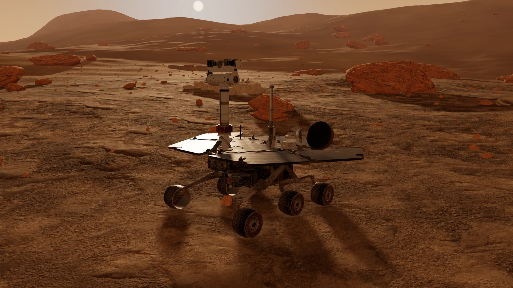
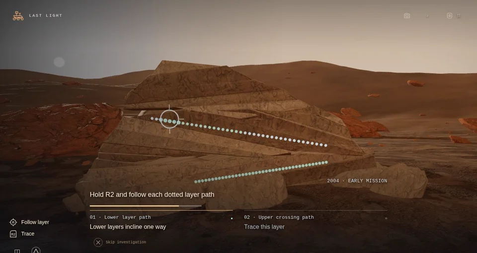
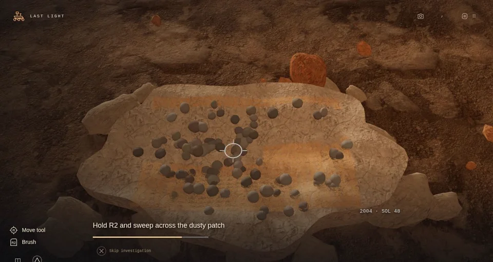

# Last Light

**You were built for ninety sols. You stayed for fourteen years.**

[](https://orion-north.github.io/last-light/)

**[Play in your browser →](https://orion-north.github.io/last-light/)** · [How to play](docs/PLAYING.md) · [Controller setup](docs/CONTROLLERS.md) · [Media & credits](docs/PRESSKIT.md) · [Bibliography](docs/BIBLIOGRAPHY.md)

[](https://github.com/Orion-North/last-light/actions/workflows/pages.yml)

A short, atmospheric 3D game about NASA’s Opportunity rover and the discoveries worth sending home. Drive across Mars, uncover evidence of ancient water, and experience a distant world through the imagined thoughts of a small explorer.

A playable project developed for the **2026 NASA Space Apps storytelling challenge**. The rover is NASA’s textured model; the landscape, story, interactions, and adaptive score are authored for the game. The cover above is rendered directly in-game.

## Explore. Investigate. Send it home.

- **Drive the rover yourself.** Cross a rocky landscape with a close camera, changing skies, and terrain feedback on compatible controllers.
- **Work with the evidence.** Trace crossing rock layers, brush dust from a surface, and compare two sample readings.
- **Frame a discovery.** Frame five mission moments: the landing site, Last Chance, Berry Bowl, Perseverance Valley and the final incomplete image. The camera looks out from the rover into the same world you explore, then reveals the original NASA observation before sending.
- **Make contact.** Squeeze both triggers, hold the signal, then release to send your discovery toward Earth.
- **Hear the journey.** An original adaptive score and musical call-and-response accompany the discoveries.

<details>
<summary><strong>See the investigations</strong> — actual gameplay</summary>

### Read the layers



### Brush the surface



</details>

## Play

**Desktop browser + controller is the primary target.** Keyboard and mouse controls are also available. The 3D scene requires WebGL 2; a story fallback is available if graphics cannot start. No install, account, or AI API key is needed.

Connect a controller, press a button, and begin. Optional original-DualSense USB trigger effects are experimental and depend on browser and device support; see [setup and limits](docs/CONTROLLERS.md). Sound can be muted, progress saves locally, and the camera button downloads a HUD-free photo.

The intended session is around 10–15 minutes; this is a design target, not a measured average. **Playable build: v0.21.1.**

## Run locally

Use Node.js 22 or newer (Node 24 is used for deployment). Dependencies are vendored; no package installation is needed.

```sh
git clone https://github.com/Orion-North/last-light.git
cd last-light
npm run dev
```

Open **http://localhost:4173**. Run `npm run check`, `npm test`, and `npm run build` to verify and build the static game. The build writes `dist/` for [GitHub Pages](docs/DEPLOYMENT.md).

## Inside the project

| Looking for… | Start here |
| --- | --- |
| Player instructions and troubleshooting | [How to play](docs/PLAYING.md) |
| A bug report or playtest feedback | [Open an issue](https://github.com/Orion-North/last-light/issues/new/choose) |
| Working on the game | [Contributing](CONTRIBUTING.md) · [Architecture](docs/ARCHITECTURE.md) |
| Coordinating Codex, Claude, or Antigravity | [Shared agent instructions](AGENTS.md) · [Task board](docs/TASKS.md) |
| Science and historical references | [NASA sources](docs/SOURCES.md) |
| Screenshots, project facts, and credits | [Media kit](docs/PRESSKIT.md) |
| Design and development history | [Plan](docs/PLAN.md) · [Soundtrack](docs/SOUNDTRACK.md) · [Verification](docs/VERIFICATION.md) |

## Credits and historical context

Opportunity’s thoughts are fictional. Terrain, navigation, instrument interactions, and power/signal behavior are artistic interpretations; mission dates and discoveries are grounded in the linked NASA sources.

Rover model: **NASA/JPL-Caltech**. Surface textures: **Rob Tuytel, Dario Barresi, and Dimitrios Savva / Poly Haven**. Renderer: **Three.js**. Full provenance and terms are recorded in the [asset ledger](public/ASSETS.csv).

This independent project is not affiliated with or endorsed by NASA. A license for the project’s original code, music, and artwork has not yet been selected; third-party assets retain their own terms.
