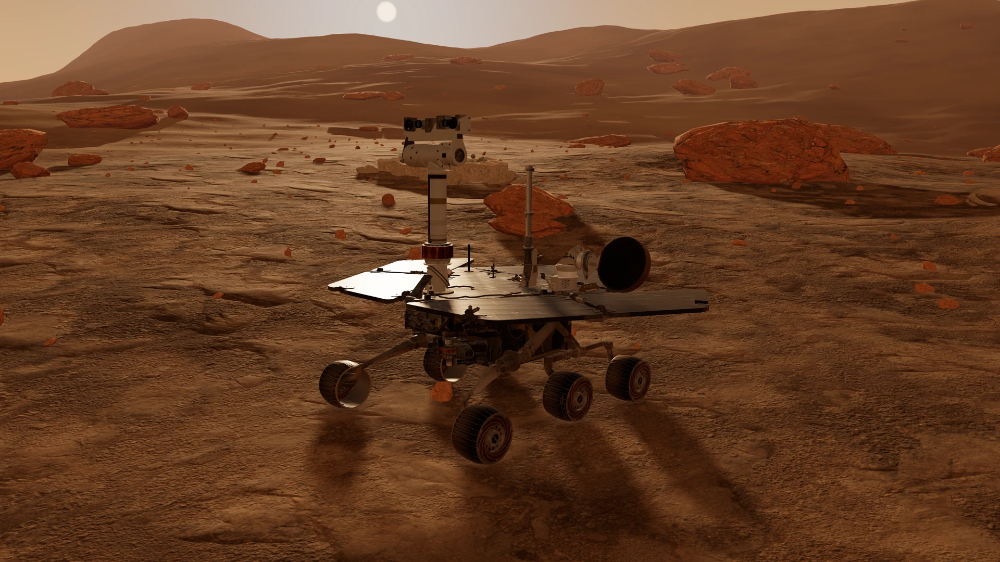
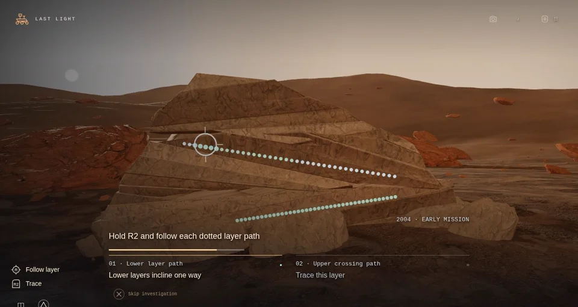
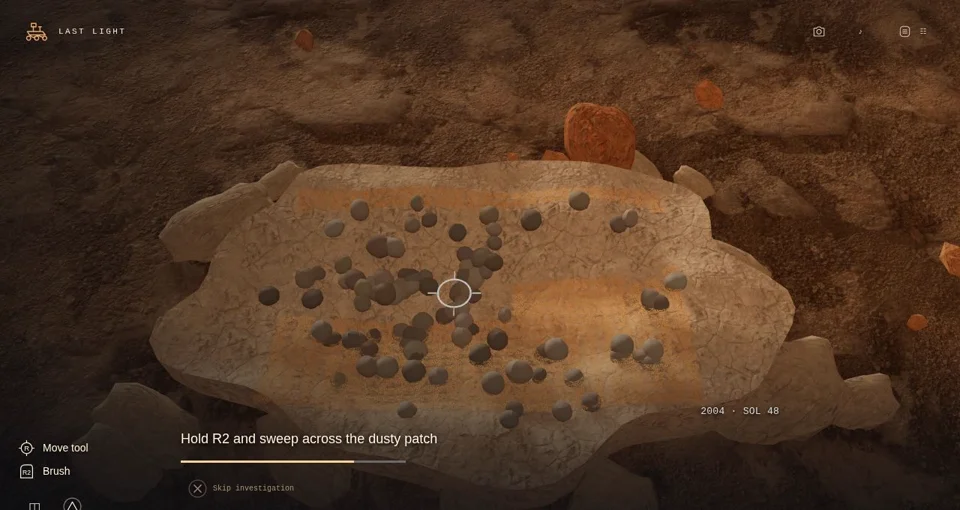

# Last Light — media kit

[Play the game](https://orion-north.github.io/last-light/) · [Repository](https://github.com/Orion-North/last-light)

## Description

Last Light is a short, atmospheric 3D browser game about NASA’s Opportunity rover and the discoveries worth sending home. Players drive across Mars, trace rock layers, brush a surface, compare readings, and send their observations toward Earth. An original adaptive score accompanies a fictional inner voice grounded in the rover’s real mission.

## Project facts

| | |
| --- | --- |
| Platform | Web; desktop and controller are the primary target |
| Current playable | v0.20.0 |
| Session | Designed for roughly 10–15 minutes; actual duration varies |
| Technology | JavaScript, Three.js, WebGL 2, Web Audio, optional WebHID |
| Development | Human-directed development with Codex and parallel AI agents |
| Context | Developed for the 2026 NASA Space Apps storytelling challenge |

## Images

The cover and screenshots below come from the actual game renderer. They are not concept art. The hero image uses a composed camera angle and no HUD; the gameplay stills come from an edited capture with scripted inputs and checkpoints.

[Download hero image — 1920 × 1080 WebP](../public/images/last-light-hero.webp)

[Layer tracing](media/layer-tracing.webp) · [Surface brushing](media/surface-brushing.webp)

## Credits and accuracy

Rover: NASA/JPL-Caltech. Terrain surface maps: Rob Tuytel, Dario Barresi, and Dimitrios Savva / Poly Haven. Rendering: Three.js. Story, environment construction, interactions, and procedural score: Last Light project. Refer to the [asset ledger](../public/ASSETS.csv) for individual provenance and terms.

Opportunity’s internal dialogue is fictional. The terrain and instrument interactions are artistic reconstructions, not NASA photographs or instrument simulations. Historical references are collected in [NASA sources](SOURCES.md); all resource links are in the [complete bibliography](BIBLIOGRAPHY.md).

This independent project is not affiliated with or endorsed by NASA. Project licensing is undecided; this media kit does not grant a blanket license to original artwork or underlying third-party material. Keep source credits with any approved use.
